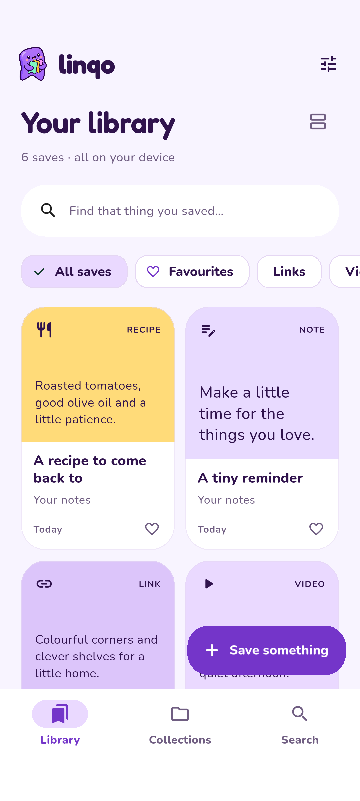
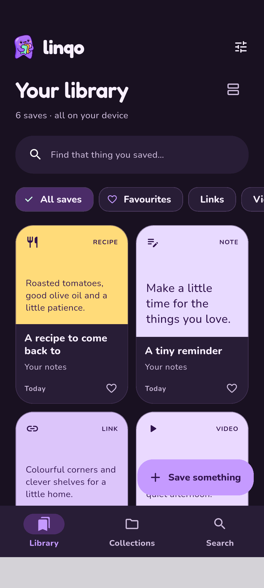

# Linqo

A private Flutter bookmark app for links, reels, videos, places, files and notes—with collections, fast local search and optional on-device AI extraction.

**Linqo is still in active development.** The current Android release is an early preview: features, previews and extraction quality are evolving. Keep originals of important files and export a library backup regularly. Cloud sync is not implemented.

[Download the latest APK](https://github.com/NotAl2/Linqo/releases) · [Report an issue](https://github.com/NotAl2/Linqo/issues) · [Buy me a coffee](https://buymeacoffee.com/notal2)


## What works today

- Save immediately into a persistent SQLite library, with favourites, editable collections and indexed search.
- Share text/links from Android apps, including Instagram, YouTube, websites and locations. Add private file copies from the file picker.
- Automatic titles and genuine cached preview images, independent of AI. Manually edited titles stay protected; **Refresh details** retries unavailable metadata.
- Automatic source text: public Instagram captions, structured recipe ingredients/steps, readable webpage text, supported public place details and YouTube descriptions are saved when exposed by the provider. No manual caption copying is needed for supported public links.
- Static video thumbnails with a play action that opens the original provider. No autoplay, embedded browser or video downloading.
- Lavender/purple mascot theme, rounded offline fonts, light/dark/system appearance, adaptive phone/tablet layouts and reduced-motion support.
- Optional English extraction: the model selects source lines for excerpt summaries, recipe details and places. Summary wording comes from saved text rather than model-written prose. A serial worker keeps browsing available, and extraction can be stopped between or during parts.
- Optional support link in **Settings → Support Linqo**. A dismissible reminder appears after the first successful save, then after a random 5–12 further saves and at least seven days, at most once per app session. It waits for a quiet library screen, with **Later** and a persistent **Don’t show again** checkbox. No donation is required to use the app.
- Export/import ZIP backups in Settings, including saves, personal notes, extraction results, favourites, collections and private file copies. Repeat imports skip previously restored saves without overwriting later edits.

 

Screenshots use synthetic demonstration saves; the app starts with your own library.

## New in v0.8.1

First-start onboarding now uses a native Flutter tutorial with lightweight transitions and interactive examples for saving and collections. It supports Skip, reduced motion and replay from **Settings → A quick tour of Linqo**. No tutorial videos or tutorial image assets are bundled. The optional model remains a separate download.

Linqo is unlimited and donation-supported. There is no paid unlock, account, purchase restoration, usage quota or licensing backend in the app. The library, search, notes, backups and optional AI run locally. Fetching captions/previews, downloading a model, manually checking GitHub releases and opening Buy Me a Coffee remain optional online features.

## New in v0.8.0 (development preview)

- A skippable welcome tour, replayable from Settings. v0.8.1 replaces the original clips with native animated tutorial examples and reduced-motion support.
- Shorter, consistent navigation feedback while keeping library state, local search and extraction independent.
- **Settings → About & updates → Check for updates** checks GitHub releases on demand, with an optional preview channel. Updates open the trusted GitHub release page for manual installation.
- Hidden **Local diagnostics**: tap the version number seven times. Opt-in logs stay local, contain event codes/error types/sanitized app stack locations, and can be exported or cleared. No saved captions, URLs, raw error messages, automatic telemetry or uploads are recorded. Native process crashes may not be captured.
- Stricter model download size/resume validation and stalled-part cancellation, retaining the existing two-thread and memory-release defaults.

The earlier tutorial clips have been removed. v1.0 remains a later optimization and bug-fixing milestone. **Linqo is still in active development.**

## Grounded extraction (v0.7.0)

- Grounded summaries use excerpts from saved content; older summaries and imported backups are re-grounded too.
- Long sources run in smaller, token-checked parts with visible progress, cancellation and explicit partial-coverage warnings. The original saved text stays intact.
- Webpage fetching prefers article bodies and filters page controls and hidden credits. General articles are less likely to be mistaken for recipes or lists of places.
- Delete and redownload the optional model in Settings. Missing or damaged files clear the installed state; a single verified model can recover a lost selection manifest.

Validated with **124 host tests**, clean static analysis and physical Redmi Note 7 Pro checks. A 6,119-character article completed all six parts in about **71 seconds** with two CPU threads; a short recipe took about **15–16 seconds**. Missing-file recovery, cancellation, deletion, a fresh checksum-verified download and extraction afterward passed. Tests used a separate library and verified that normal library data and preferences were unchanged. Performance and content coverage still vary by device and provider.

The current v0.8.1 ARM64 APK is approximately **72.5 MB**; the optional model download is approximately **397 MB**. These are file sizes, not total Android installed storage or runtime memory requirements. Linqo remains an **active-development preview**.

## Install

Download the **ARM64 APK** from [Releases](https://github.com/NotAl2/Linqo/releases). Requires **Android 10 / API 29 or newer** on an ARM64 device. Allow installation from your browser/file manager when Android asks.

Install updates over the existing app to retain saves and settings. **Uninstalling or clearing app data deletes saves, collections, notes, imported file copies and models.** This preview uses the existing development signing identity to remain compatible with earlier test installs; it is not a Play Store/production-signed release. A later signing transition may require an explicit migration.

No model is bundled or downloaded automatically. The APK works as a bookmark library without AI. Release assets include a SHA-256 checksum file.

## Optional on-device AI

Settings offers a resumable, checksum-verified download of [Qwen3-0.6B Q4_K_M](https://huggingface.co/unsloth/Qwen3-0.6B-GGUF/blob/50968a4468ef4233ed78cd7c3de230dd1d61a56b/Qwen3-0.6B-Q4_K_M.gguf): **396,705,472 bytes**, about **397 MB**. Importing a local GGUF is also supported. Model licenses are separate from the app license.

Inference runs locally through llamadart/llama.cpp with **two CPU threads**, a 2,048-token context and one active extraction at a time. Long sources run as token-checked parts within that context, with visible progress. Selection persists; weights load on demand and unload after processing/backgrounding. Settings can delete the optional model and download it again. Startup, foreground recovery, Settings and model loading recheck the private model files; missing/damaged files stop being advertised as installed. Download size is not a RAM estimate: inference can use considerably more memory and depends on your device.

Sharing or saving a link starts public content fetching automatically. The fetched caption, recipe or webpage text appears in **Content for extraction**, independently of the optional model. Sender-provided text is retained; manually edited source text and **Your notes** stay protected. A source label distinguishes captions, caption excerpts, webpage text and video descriptions; a YouTube description is not a transcript.

With a model installed, **Settings → Summarize saves automatically** defaults on. New saves can queue English summarization after their source text arrives; each save can opt out, and Stop remains available. Existing empty link saves are eligible for content fetching after migration. Failed public fetches can retry on restart or returning to the foreground; repeated foreground recovery has a one-minute cooldown per app session. **Retry content fetch** and **Refresh details** are also available. No model is downloaded automatically. Review generated results; source citations do not guarantee factual accuracy.

## Limitations and next work

- Public title/image previews are best effort. Private, removed, region-restricted or login-only posts may show a platform fallback; Instagram access is not guaranteed.
- Public content extraction is best effort. Login walls, private posts, JavaScript-only pages and unavailable descriptions can expose no text. Metadata-only captions are marked as excerpts; no login/session bypass is used.
- Video/audio transcription, protected captions, OCR, semantic search and sync are not implemented. YouTube descriptions are supported where public HTML exposes them; arbitrary YouTube subtitle-track downloads are not implemented.
- Up to 30,000 source characters are retained; bounded/truncated fetched content is marked partial. Extraction handles that saved text in up to 64 token-checked parts, without increasing context/RAM settings. Incomplete processing is explicitly marked partial and never overwrites the full saved text. Summaries are original excerpts separated by ellipses; selection can still miss context and should be reviewed. Older summaries are re-grounded on upgrade without changing personal notes, titles, collections or model settings. Broader accuracy, thermal, battery and low-memory testing remains necessary.
- File-provider/viewer compatibility and more Android/OEM combinations need testing. Android sharing currently receives text/link shares, not arbitrary image/video-only shares.
- Flutter code is shared, but **no native iOS target is implemented or tested yet**.
- `file_picker` currently emits a Flutter/Kotlin migration warning. It builds with the pinned toolchain; a plugin upgrade is needed before a future incompatible Flutter upgrade.

The [automatic content report](docs/AUTOMATIC_CONTENT.md) and earlier [release review](docs/RELEASE_REVIEW.md) record checks, fixes and practical test boundaries.

## Privacy and storage

**Settings → Export saves** writes a portable ZIP to your chosen destination. **Import saves** merges a Linqo backup into the current library; it preserves current settings and does not replace existing saves. Model weights, model selection, transient Android share receipts and cached preview images are excluded. Use Refresh details to fetch missing covers again. Backups are unencrypted and contain your saved text and file copies; keep them private. Version 1 supports up to 10,000 saves, 16 MiB of library text and 512 MiB of file copies. Missing private file copies cause export to fail rather than silently omit them.

Saves and file copies live in private app storage. No account is required for the library, and no hosted inference service or cloud sync is used. Android cloud backup is disabled. Adding/sharing or refreshing a link contacts its public provider for metadata/images; optional model setup contacts Hugging Face, and the support button opens Buy Me a Coffee externally. Update checks contact GitHub only on request. Local diagnostics are disabled by default and exported only by the user.

Metadata/content fetching is bounded to two jobs, a ten-second deadline, 1 MiB HTML per response and 700 KiB per image. The thumbnail disk cache is expendable and capped at 16 MiB/80 entries. Browsing uses local cached previews. No login cookies, WebView or JavaScript runtime are used for previews.

## Build and test

Validated toolchain: **Flutter 3.47.7 / Dart 3.13.5**, **Java 21**, Android SDK API 36. Install/configure Flutter and Android SDK first; SDKs, caches, model weights and signing secrets are excluded from this repository.

```sh
flutter pub get
flutter analyze
flutter test
flutter run -d <android-device-id>
flutter build apk --release --target-platform android-arm64 --target=lib/main.dart
```

The APK is written to `build/app/outputs/flutter-apk/app-release.apk`. On Windows, `scripts/flutter.ps1` uses ignored project-local tools when present and otherwise your installed Flutter. Release builds currently use the local Android debug signing key; do not distribute private keys in source. Forks build with their own local key, so their APKs cannot update a differently signed installed app.

Device integration harnesses live in `integration_test/`. They use separate QA databases, and some require a selected model or a host-side viewport coordinator. Read each harness before running it. Always build `lib/main.dart` for distribution, rather than a test entry point.

## Code map

| Path | Purpose |
|---|---|
| `lib/library` | SQLite, collections, search and processing orchestration |
| `lib/sharing` | Incoming text/link shares and bounded metadata/image fetching |
| `lib/ui`, `lib/theme.dart` | Native Flutter screens, mascot theme and responsive layouts |
| `lib/domain` | Extraction schema, source evidence and recovery rules |
| `lib/inference` | Model import, optional download and native runtime |
| `android` | Android platform and durable share inbox |
| `test`, `integration_test` | Host regressions and device harnesses |

Bug reports and contributions are welcome. Include Android/device details, reproduction steps and a redacted example when reporting preview or extraction problems. Please avoid posting private saves or model files.

## License and support

Original code: [Apache License 2.0](LICENSE). Fonts, dependencies and optional models retain their own licenses; see [third-party notices](THIRD_PARTY_NOTICES.md), the [accompanying license bundle](THIRD_PARTY_LICENSES.txt) attached to Releases, and **Settings → Open-source licenses**. Keep the license bundle with redistributed APKs; native runtime attribution supplements Flutter's generated list. The license does not grant trademark rights.

If Linqo is useful to you, [buy me a coffee](https://buymeacoffee.com/notal2) to support its development. Donations are optional.
